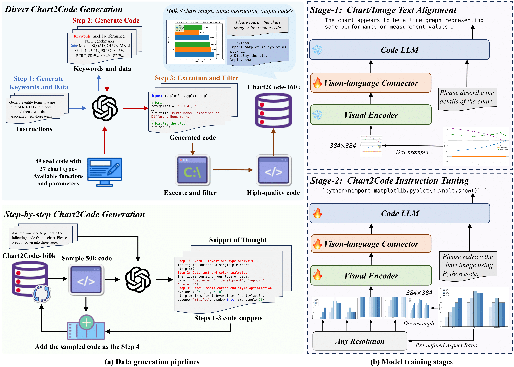
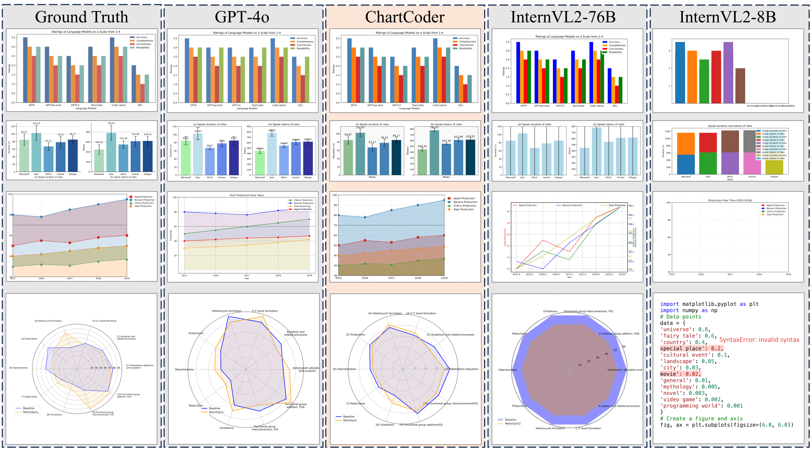

# ChartCoder: Advancing Multimodal Large Language Model for Chart-to-Code Generation (ACL 2025 Main)

[](https://huggingface.co/datasets/xxxllz/Chart2Code-160k)  [](https://modelscope.cn/datasets/Noct25/Chart2Code-160k)  [](https://huggingface.co/xxxllz/ChartCoder) [](https://arxiv.org/abs/2501.06598)

This repository is the official implementation of [ChartCoder: Advancing Multimodal Large Language Model for Chart-to-Code Generation
](https://arxiv.org/abs/2501.06598). 

> ChartCoder: Advancing Multimodal Large Language Model for Chart-to-Code Generation
>
> Xuanle Zhao*, Xianzhen Luo*, Qi Shi†, Chi Chen†, Shuo Wang, Zhiyuan Liu, Maosong Sun

## Notes
*We find that our evaluation on ChartMimic utilized the 'no_filter' option previously, which led to performance discrepancies. Upon re-evaluating with the default 'code_pass' setting, we observe the low-level score change to **72.5**, while the high-level score remains unchanged.*

More information about evaluation

1. ChartCoder is tested on the new version of Chartmimic, which contains 600 samples. The iclr version of ChartMimic is https://huggingface.co/datasets/ChartMimic/ChartMimic/blob/main/dataset-iclr.tar.gz.
2. The code we utilize for evaluation is the Supplementary Material of https://openreview.net/forum?id=sGpCzsfd1K.

All the results (including the baseline and our models) in Table 3 in the paper are evaluated based on the above two settings. When conducting assessments in other settings, performance differences may occur. If you want to reproduce the performance in the paper, it is recommended that you do it under the aforementioned settings.

## News

**[2025.11.11]** Sorry that we find some code in Chart2Code-160k contain errors. We have fixed this in the [VinciCoder-1.6M-SFT(Chart2Code)](https://huggingface.co/datasets/DocTron-Hub/VinciCoder-1.6M-SFT/blob/main/chart2code_1.parquet). This parquet file contains Chart2Code-160k direct generation data without bugs and issues. If you want to utilize the SoT data, please follow the corresponding JSON file in [Chart2Code-160k](https://huggingface.co/datasets/xxxllz/Chart2Code-160k/blob/main/json.tar.gz). Also, welcome to follow [VinciCoder](https://github.com/DocTron-hub/VinciCoder).

**[2025.5.17]** ChartCoder has been accepted by **ACL 2025 Main**.

**[2025.3.13]** We have upload our dataset [Chart2Code-160k(HF)](https://huggingface.co/datasets/xxxllz/Chart2Code-160k) to Huggingface.

**[2025.2.19]** We have released our dataset [Chart2Code-160k](https://modelscope.cn/datasets/Noct25/Chart2Code-160k) to ModelScope.

**[2025.1.16]** We have updated our data generation code [data_generator](https://github.com/thunlp/ChartCoder/tree/main/data_generator), built on [Multi-modal-Self-instruct](https://github.com/zwq2018/Multi-modal-Self-instruct). Please follow their instructions and our code to generate the <chart, code> data pairs.

## Overview



## Installation
1. Clone this repo
```
git clone https://github.com/thunlp/ChartCoder.git
```
2.  Create environment
```
cd ChartCoder
conda create -n chartcoder python=3.10 -y
conda activate chartcoder
pip install --upgrade pip  # enable PEP 660 support
pip install -e .
```
3. Additional packages required for training
```
pip install -e ".[train]"
pip install flash-attn --no-build-isolation
```

## Models
|  Model   | Download Link  |
|  ----  | ----  |
| MLP Connector |  [projector](https://drive.google.com/file/d/1S_LwG65TIz_miW39rFPhuEAb5ClgopYi/view?usp=drive_link)  |
| ChartCoder  |  [ChartCoder](https://huggingface.co/xxxllz/ChartCoder)  |

The MLP Connector is our pre-trained MLP weights, which you could directly use for SFT.

## Data
|  Dataset  | Download Link  |
|  ----  | ----  |
|Chart2Code-160k  | [HuggingFace](https://huggingface.co/datasets/xxxllz/Chart2Code-160k) |
|Chart2Code-160k  | [ModelScope](https://modelscope.cn/datasets/Noct25/Chart2Code-160k)|

## Train
The whole training process consists of two stages. To train the ChartCoder, ```siglip-so400m-patch14-384``` and ```deepseek-coder-6.7b-instruct``` should be downloaded first.

For **Pre-training**, run
```
bash scripts/train/pretrain_siglip.sh
```
For **SFT**, run 
```
bash scripts/train/finetune_siglip_a4.sh
```
Please change the model path to your local path. See the corresponding ```.sh ``` file for details. 
We also provide other training scripts, such as using CLIP ```_clip``` and multiple machines ```_m```. See ``` scripts/train ``` for further information.

## Inference
Please see ```inference.py``` for details.

## Results
Please refer to our paper for detailed performance on ChartMimic, Plot2Code and ChartX benchmarks. Thanks for these contributions to the chart-to-code field.


## Contact

For any questions, you can contact [2429527z@gmail.com](mailto:2429527z@gmail.com).


## Citation
If you find this work useful, consider giving this repository a star ⭐️ and citing 📝 our paper as follows:
```
@article{zhao2025chartcoder,
  title={Chartcoder: Advancing multimodal large language model for chart-to-code generation},
  author={Zhao, Xuanle and Luo, Xianzhen and Shi, Qi and Chen, Chi and Wang, Shuo and Liu, Zhiyuan and Sun, Maosong},
  journal={arXiv preprint arXiv:2501.06598},
  year={2025}
}
```

## Acknowledgement
The code is based on the [LLaVA-NeXT](https://github.com/LLaVA-VL/LLaVA-NeXT). Thanks for these great works and open sourcing!
